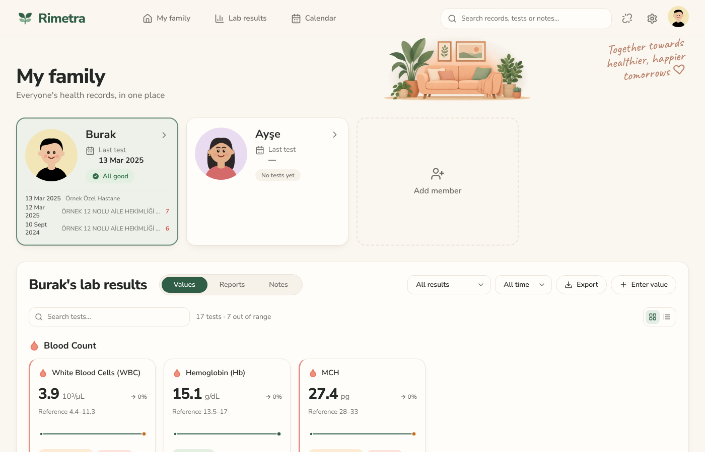
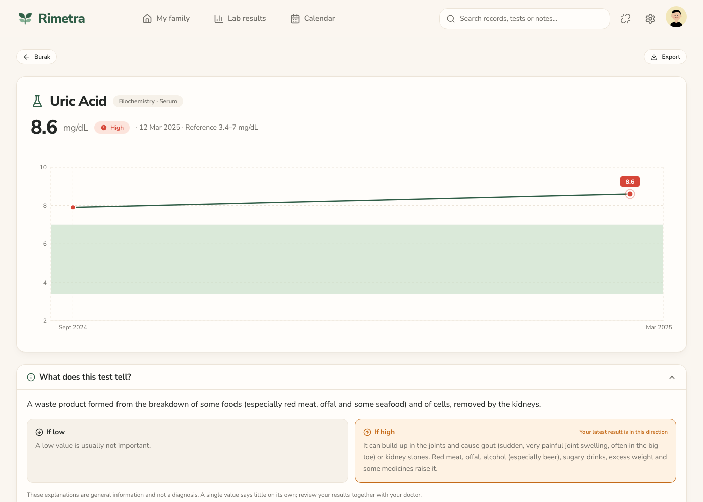

# Rimetra — Family Lab Results Tracker

A self-hosted web app that collects your family's lab results in one place, shows trends over time, and lets an AI agent enter results through an API / MCP server. It was built around PDFs from **e-Nabız** (Turkey's national health portal), but any lab report can be entered as JSON or by hand.

The interface is available in **Turkish and English** (switch in the profile menu). The Telegram bot, CSV/PDF exports and the built-in test explanations follow the selected language.

> ⚕️ **Not medical advice.** Rimetra is only a record-keeping and visualisation tool; it does not diagnose or recommend treatment. Always review your results with your doctor. Test explanations are general information.
>
> 🔒 Health data is sensitive. Do not expose the app directly to the internet; if you need outside access, put it behind HTTPS (e.g. Cloudflare Tunnel, Tailscale, a reverse proxy) and change every key in `.env`. The app refuses to start with the example keys.

> All sample and test data in this repository (names, facilities, dates, values) is fictional.

## Screenshots

| Family dashboard | Test detail |
|---|---|
|  |  |

## Features

- Sign-in (argon2id passwords, increasing delay after failed attempts); master / member / no-sign-in profile roles; read-only members
- Family dashboard, member detail (Values / Reports / Notes), test detail with reference band, note markers and colour strips for qualitative tests
- Server-side parsing and flagging of raw lab values (`&lt;41`, `Pozitif (++)`, `.` placeholders, repeated names, specific-gravity scale rule…)
- Three-layer duplicate protection (content fingerprint, result level, PDF hash) + `Idempotency-Key` + `dry_run`
- Warning when the flag on the document and the computed flag disagree
- Unmatched tests screen, editable test catalog (124 built-in tests with plain-language explanations) and scale rules
- Report comparison, "out of range in two reports in a row" highlight
- CSV and trend-PDF export for the doctor
- Check-up reminders, calendar, manual entry (blood pressure, weight…)
- API keys (scopes + member restriction, rate limit), MCP server, audit log
- Encrypted PDF storage, encrypted daily backups, 30-day restore for deleted reports
- Dark mode, mobile friendly, PWA
- Telegram bot: persistent buttons, search by test name, trend charts, PDFs, new result notifications

## Installation (Docker)

```bash
git clone <repo> rimetra && cd rimetra
cp .env.example .env
nano .env            # change SECRET_KEY, DATA_ENCRYPTION_KEY and POSTGRES_PASSWORD
docker compose up -d --build
```

Open `http://<server-ip>:8080` (port = `APP_PORT` in `.env`).

Generate keys with: `python3 -c "import secrets; print(secrets.token_urlsafe(48))"`

**First master user** — either:

- fill in `INITIAL_MASTER_USERNAME` / `INITIAL_MASTER_PASSWORD` (and optionally `INITIAL_MASTER_DISPLAY_NAME`) in `.env` before starting, and clear them after the first sign-in, or
- run `docker compose exec app rimetra create-master`

> `DATA_ENCRYPTION_KEY` encrypts PDFs and backups. **If you lose it, encrypted files cannot be opened** — store it somewhere safe.

The `.env` comments are in Turkish; every variable is also described here:

| Variable | Meaning |
|---|---|
| `APP_PORT` | Host port of the web app |
| `TZ` | Time zone (display and backup time) |
| `SECRET_KEY` | Signs sessions and preview tokens |
| `DATA_ENCRYPTION_KEY` | Encrypts PDFs and backups on disk |
| `COOKIE_SECURE` | `true` only behind HTTPS |
| `PUBLIC_BASE_URL` | External address shown in API/MCP examples |
| `POSTGRES_*` | Database name, user and password |
| `DATA_DIR` | Host folder for PDFs, avatars and backups |
| `BACKUP_*` | Daily backup on/off, hour, retention days |
| `TELEGRAM_BOT_TOKEN` | Token from @BotFather (empty = bot off) |
| `TELEGRAM_NOTIFY` | Notify linked users when a new result is added |

### Updating

```bash
git pull
docker compose up -d --build     # the database schema is migrated automatically (alembic)
```

## Admin commands

```bash
docker compose exec app rimetra create-master
docker compose exec app rimetra reset-password <user>
docker compose exec app rimetra backup
docker compose exec app rimetra restore /data/backups/rimetra-YYYYMMDD-HHMMSS.tar.enc
docker compose restart app       # after a restore
```

## Agent connection (MCP)

1. Admin → **API keys** → create a key (shown only once).
2. REST: `http://<server>:8080/api/v1` · MCP: `http://<server>:8080/mcp` — both with `Authorization: Bearer rmt_live_…`.
3. Admin → **Agent connection** has ready-made setup steps for Codex and Claude Code.

The agent-facing texts (MCP tool descriptions and the `SKILL.md` that teaches agents to read e-Nabız PDFs) are in Turkish; AI agents handle them fine.

## Telegram bot

1. On Telegram, message [@BotFather](https://t.me/BotFather) → `/newbot`.
2. Put the token in `.env`: `TELEGRAM_BOT_TOKEN=123456:ABC...`
3. `docker compose up -d --build`. Admin → **Telegram bot** should show "running".

Each user links their own account from the profile menu → **Link Telegram**. The bot answers with that user's permissions and never changes data. It speaks the user's language (profile setting, otherwise the Telegram app language). English commands: `/menu /people /out /last /reports /values /checkups /pdf /settings /help`.

## Development

```bash
# backend
cd backend && pip install -e ".[test]"
export DATABASE_URL=postgresql+psycopg://postgres@localhost:5432/rimetra
export ALLOW_INSECURE_KEYS=true   # local only: allows starting with example keys
alembic upgrade head && uvicorn app.main:app --reload --port 8000

# frontend (separate terminal) — /api requests are proxied to 8000
cd frontend && npm install && npm run dev

# tests (needs an empty test database)
DATABASE_URL=postgresql+psycopg://postgres@localhost:5432/rimetra_test pytest
```

### Translations

Turkish source texts are used as translation keys:

- UI: `t("Metin")` in components; English in [`frontend/src/locales/en.ts`](frontend/src/locales/en.ts). Check coverage with `cd frontend && npm run i18n:check`.
- Server (error messages, Telegram bot, PDF/CSV): `t()` in `backend/app/i18n.py`; translations in `backend/app/locales/`.
- Test catalog (names, categories, explanations): `backend/app/catalog_en.py`.
- Request language: `X-Rimetra-Lang` header > `?lang=` > `Accept-Language` > Turkish. The user's choice is stored in `users.lang`.

## License

**Apache License 2.0 with the Commons Clause** — see [`LICENSE`](LICENSE) and [`NOTICE`](NOTICE).

- ✅ Anyone, including companies, may install, use, modify and share Rimetra for free, including for internal use.
- ❌ You may not **sell** Rimetra, or a product or service whose value derives substantially from it (including hosting, setup or support), to third parties.
- 📝 Keep the copyright and `NOTICE`; mark files you change; don't present "Rimetra" as your own product.
