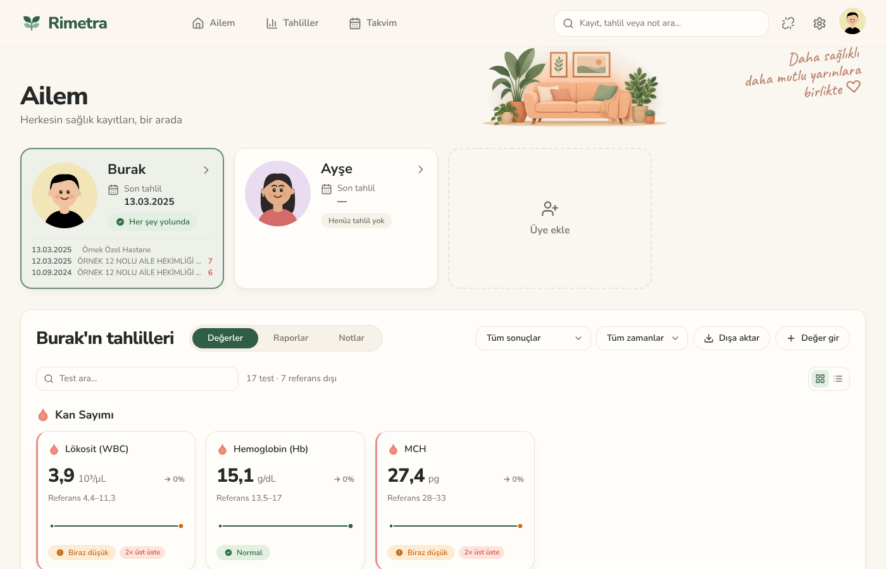
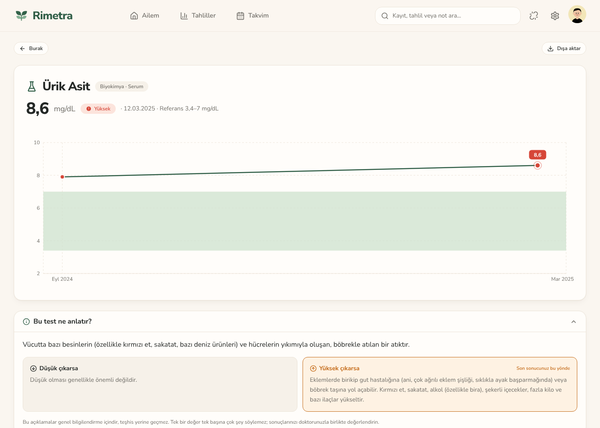

# Rimetra — Aile Tahlil Takip Sistemi

🇬🇧 **English:** [README.en.md](README.en.md)

e-Nabız PDF'lerinden gelen tahlil sonuçlarını aile üyeleri için tek yerde toplayan, trendleri gösteren ve bir yapay zeka ajanının API/MCP üzerinden veri girebildiği, kendi sunucunda çalışan web uygulaması. Ayrıntılı gereksinimler: [`RIMETRA.md`](RIMETRA.md), API: [`docs/api.md`](docs/api.md).

> ⚕️ **Tıbbi tavsiye değildir.** Rimetra yalnızca kayıt ve görselleştirme aracıdır; teşhis koymaz, tedavi önermez. Sonuçlarınızı her zaman doktorunuzla değerlendirin. Test açıklamaları genel bilgi amaçlıdır.
>
> 🔒 Sağlık verisi hassastır. Uygulamayı doğrudan internete açmayın; dışarıdan erişim gerekiyorsa HTTPS (ör. Cloudflare Tunnel, Tailscale, ters vekil) arkasına alın ve `.env` içindeki tüm anahtarları değiştirin. Örnek anahtarlarla uygulama açılmaz.

> Depodaki tüm örnek ve test verileri (kişi adları, kurumlar, tarihler, değerler) kurgusaldır.

## Ekran görüntüleri

| Aile paneli | Test detayı |
|---|---|
|  |  |

## Kurulum (Ubuntu + Docker)

```bash
git clone <repo> rimetra && cd rimetra
cp .env.example .env
nano .env            # SECRET_KEY, DATA_ENCRYPTION_KEY, POSTGRES_PASSWORD'ü değiştirin
docker compose up -d --build
```

Tarayıcıdan: `http://<sunucu-ip>:8080` (port `.env` içindeki `APP_PORT`).

**İlk master kullanıcı** — iki yoldan biri:

- `.env` içinde `INITIAL_MASTER_USERNAME` / `INITIAL_MASTER_PASSWORD` (ve isteğe bağlı `INITIAL_MASTER_DISPLAY_NAME=Burak`) doldurup başlatın; ilk girişten sonra bu satırları boşaltın.
- veya: `docker compose exec app rimetra create-master`

> `DATA_ENCRYPTION_KEY` PDF'leri ve yedekleri şifreler. **Kaybederseniz şifreli dosyalar açılamaz** — güvenli bir yere not edin.

### Docker yapısı

`docker-compose.yml` içinde `name: rimetra` tanımlıdır; Portainer'da / `docker compose ls` çıktısında tek bir **rimetra** stack'i görünür:

| Container | İçerik |
|---|---|
| `rimetra-app` | FastAPI backend + derlenmiş React arayüzü (tek imaj, tek port) |
| `rimetra-db` | PostgreSQL 16 (veri `rimetra-db` volume'ünde) |

PDF'ler, avatarlar ve yedekler host'ta `./data` klasöründe durur (`DATA_DIR`). `.env` ve `data/` git tarafından yok sayılır; sunucuda `git pull` yaptığınızda ayarlarınız ve verileriniz korunur.

### Güncelleme

```bash
git pull
docker compose up -d --build     # veritabanı şeması açılışta otomatik güncellenir (alembic)
```

### HTTP / HTTPS

Uygulama yerel ağda düz HTTP ile çalışacak şekilde ayarlıdır (`COOKIE_SECURE=false`). İleride Cloudflare Tunnel / Tailscale / ters vekil ile HTTPS arkasına alırsanız `.env` içinde `COOKIE_SECURE=true` ve `PUBLIC_BASE_URL=https://...` yapın; HSTS başlığı o zaman otomatik açılır.

## Yönetim komutları

```bash
docker compose exec app rimetra create-master            # master kullanıcı
docker compose exec app rimetra reset-password <kullanıcı>
docker compose exec app rimetra backup                   # şimdi yedek al
docker compose exec app rimetra restore /data/backups/rimetra-YYYYMMDD-HHMMSS.tar.enc
docker compose restart app                               # geri yüklemeden sonra
```

Günlük otomatik yedek `BACKUP_HOUR` saatinde alınır (veritabanı + PDF + avatar, şifreli tek dosya) ve `BACKUP_RETENTION_DAYS` gün saklanır. Yönetim → Yedekleme ekranından da alınıp indirilebilir. Yedekleri ayrıca başka bir diske/buluta kopyalamanız önerilir (ör. `restic` ile `./data/backups`).

## Ajan bağlantısı

1. Yönetim → **API anahtarları** → anahtar oluşturun (yalnızca bir kez gösterilir).
2. REST: `http://<sunucu>:8080/api/v1` · MCP: `http://<sunucu>:8080/mcp` — ikisi de `Authorization: Bearer rmt_live_…`.
3. Yönetim → **Ajan bağlantısı** sekmesinde hazır yapılandırma örnekleri var.

İnternetteki bir ajanın (ör. claude.ai) erişmesi için sunucunun dışarıdan HTTPS ile erişilebilir olması gerekir (Cloudflare Tunnel önerilir). Aynı ağdaki Claude Code / masaüstü istemciler doğrudan bağlanabilir.

## Telegram botu

Sonuçlara telefondan Telegram ile de bakılabilir. Bot, bağlı hesabın yetkisiyle yanıt verir (yönetici tüm aileyi, üye yalnızca kendi profilini görür) ve **hiçbir veriyi değiştirmez**.

**Kurulum (bir kerelik):**

1. Telegram'da [@BotFather](https://t.me/BotFather) → `/newbot` → bota ad ve `…bot` ile biten kullanıcı adı verin.
2. Verilen anahtarı `.env` dosyasına yazın: `TELEGRAM_BOT_TOKEN=123456:ABC...`
3. `docker compose up -d --build` (Portainer'da stack → **Update**). Yönetim → **Telegram botu** sekmesinde "çalışıyor" görünmeli.

Bot Telegram'a kendisi bağlanır (long polling); port açmak, HTTPS veya Cloudflare Tunnel gerekmez — sunucunun internete çıkabilmesi yeterli.

**Hesap bağlama** — iki yol:

- **Kendi kendine (önerilen):** Rimetra'ya giriş yap → sağ üstte profil menüsü → **Telegram** → **Telegram'ı bağla**. Telefonda doğrudan Telegram açılır, bilgisayarda QR kod okutulur; sohbette **BAŞLAT**'a dokunmak yeterli. Bağlantı 15 dakika geçerli ve tek kullanımlıktır.
- **Yönetici eliyle:** kişi bota herhangi bir şey yazınca bot ona Telegram ID'sini söyler. Yönetim → Üyeler → **Hesap** → **Telegram ID** alanına yazılır.

**Botta:** alttaki kalıcı butonlar (Referans dışı · Son rapor · Raporlar · Tüm değerler · Kişi seç · Kontroller), test adı yazınca grafikli geçmiş (`ferritin`, `ayşe b12`), raporun orijinal PDF'i, doktor için PDF özeti, test açıklamaları ve yeni tahlil bildirimi. Komutlar: `/menu /kisi /disi /son /raporlar /degerler /kontrol /pdf /ayarlar /yardim`.

> Telegram bot sohbetleri uçtan uca şifreli değildir; mesajlar Telegram sunucularından geçer. Hesap pasifleştirilirse ya da bağlantı kaldırılırsa bot o sohbete yanıt vermeyi hemen keser.

## Özellikler

- Giriş (argon2id şifre, artan bekleme), master / üye / girişsiz profil rolleri, üye salt-okunur ayarı
- Aile paneli, üye detayı (Değerler / Raporlar / Notlar), test detayı (referans bandı, not işaretleri, nitel testler için renkli şerit)
- Sunucu tarafı ayrıştırma ve işaretleme (`&lt;41`, `Pozitif (++)`, `Negatif 0.04`, `.` yer tutucu, tekrarlanan adlar, dansite ölçek kuralı)
- Üç katmanlı mükerrer kontrolü (içerik parmak izi, sonuç düzeyi, PDF hash) + `Idempotency-Key` + `dry_run`
- Kaynak işaret ile hesaplanan işaret uyuşmazlığı uyarısı (⚠)
- Eşleşmemiş testler ekranı, test kataloğu ve ölçek kuralları
- Rapor karşılaştırma, “üst üste iki raporda referans dışı” vurgusu
- CSV ve trend PDF'i dışa aktarım (doktor için; tüm testler ya da seçilenler, çok sayfa)
- Kontrol hatırlatıcıları, takvim, elle değer girişi (tansiyon, kilo…)
- API anahtarları (scope + üye kısıtı, 60 istek/dk), MCP sunucusu, denetim kaydı
- Şifreli PDF saklama, şifreli günlük yedek, silinen raporu 30 gün içinde geri alma
- Karanlık mod, mobil uyum, PWA (ana ekrana eklenebilir)
- Türkçe ve İngilizce arayüz (profil menüsünden seçilir; Telegram botu, CSV/PDF dışa aktarım ve test açıklamaları da seçilen dilde)
- Telegram botu: kalıcı butonlar, test adıyla arama, trend grafiği, PDF, yeni tahlil bildirimi

## Geliştirme

```bash
# backend
cd backend && pip install -e ".[test]"
export DATABASE_URL=postgresql+psycopg://postgres@localhost:5432/rimetra
export ALLOW_INSECURE_KEYS=true   # yalnızca yerelde: örnek anahtarlarla açılmaya izin verir
alembic upgrade head && uvicorn app.main:app --reload --port 8000

# frontend (ayrı terminal) — /api istekleri 8000'e yönlendirilir
cd frontend && npm install && npm run dev

# testler (boş bir test veritabanı gerekir)
DATABASE_URL=postgresql+psycopg://postgres@localhost:5432/rimetra_test pytest
```

### Dil desteği / çeviri

Kaynak metinler Türkçedir ve çeviri anahtarı olarak kullanılır:

- Arayüz: bileşenlerde `t("Metin")`; İngilizce karşılıklar [`frontend/src/locales/en.ts`](frontend/src/locales/en.ts). Eksik çeviri kontrolü: `cd frontend && npm run i18n:check`
- Sunucu (hata mesajları, Telegram botu, PDF/CSV): `app/i18n.py` içindeki `t()`; karşılıklar `backend/app/locales/`
- Test kataloğu (adlar, kategoriler, açıklamalar): `backend/app/catalog_en.py`
- İstek dili: `X-Rimetra-Lang` başlığı > `?lang=` > `Accept-Language` > Türkçe. Kullanıcının tercihi `users.lang` alanında saklanır.

## Klasör yapısı

```
backend/
  app/            FastAPI: api/ (v1, app, auth, mcp), services/ (ingest, queries, backup, export…),
                  parsing.py (ayrıştırma + işaretleme), catalog_seed.py (test kataloğu), models.py
  alembic/        veritabanı migration'ları
  tests/          kabul kriterleri testleri
frontend/         React + Vite + TypeScript + Tailwind + Recharts
docs/             api.md
Dockerfile        çok aşamalı: frontend derlenir → backend imajına kopyalanır
docker-compose.yml
.env.example
```

## Lisans

**Apache License 2.0 + Commons Clause** — ayrıntı: [`LICENSE`](LICENSE), [`NOTICE`](NOTICE).

- ✅ Herkes — şirketler dahil — Rimetra'yı ücretsiz kurup kendi içinde kullanabilir, değiştirebilir ve paylaşabilir.
- ❌ Rimetra'yı ya da büyük ölçüde ona dayanan bir ürünü/hizmeti (barındırma, kurulum, destek dahil) üçüncü kişilere **ücret karşılığı satmak** yasaktır.
- 📝 Telif ve `NOTICE` bildirimleri silinemez; değiştirdiğiniz dosyaları belirtmeniz gerekir; "Rimetra" adı başkasının ürünü gibi kullanılamaz.
